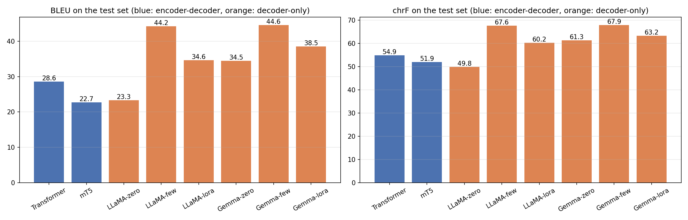
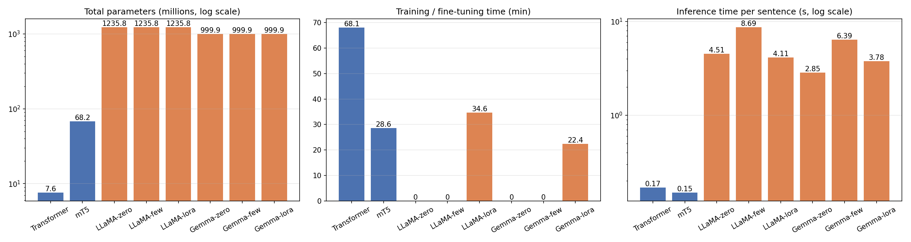
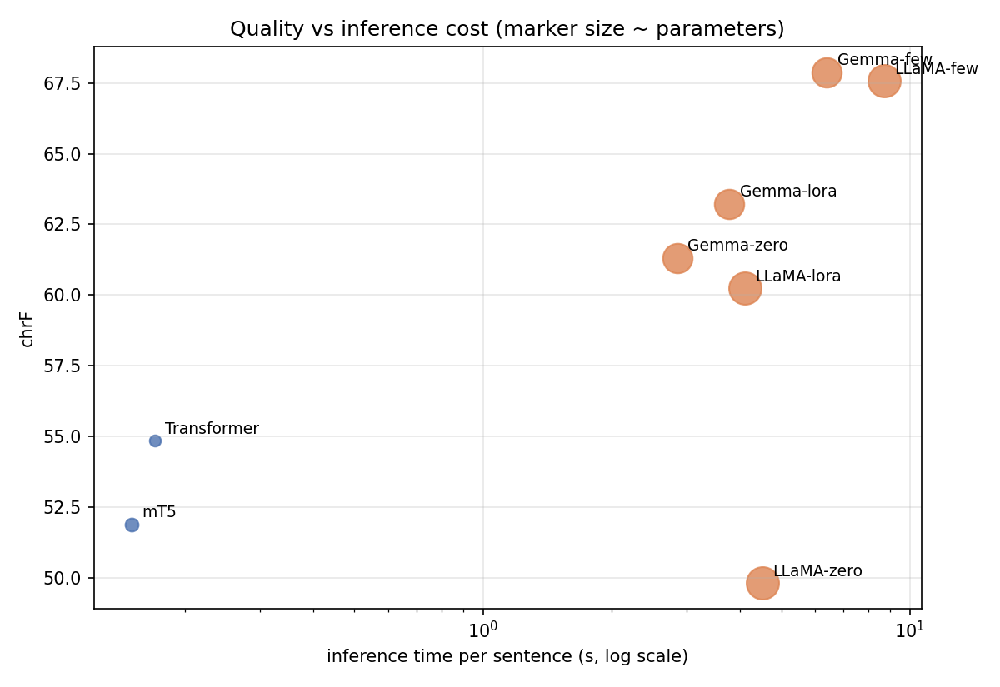
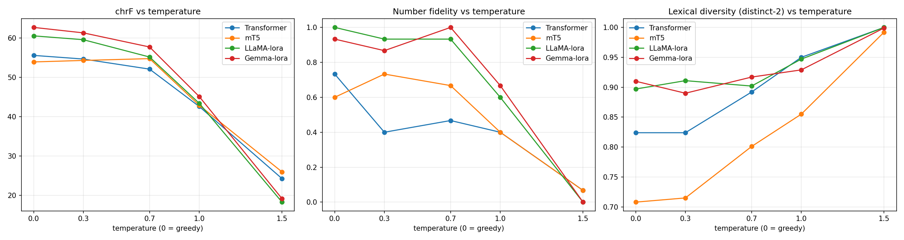

# English → Spanish Medical Leaflet Translation: Transformer, mT5, LLaMA and Gemma

Foundations of Generative AI (ICT4403), Assignment 3

Dishank Shah, Reg. No. 230953490

## 1. Problem statement and objective

Machine translation of medicine information is a setting where a fluent but wrong translation can hurt someone: a dropped "not", a changed dose or a misread warning can change what a patient does. This project builds English → Spanish translation systems for **medicine package leaflets and product information** and compares two families of architecture:

| Family | Model | How it is adapted here |
|---|---|---|
| Encoder-decoder | Basic Transformer | trained from scratch |
| Encoder-decoder | mT5-small | full fine-tuning |
| Decoder-only | LLaMA 3.2 1B Instruct | zero-shot prompting, retrieved few-shot prompting, LoRA fine-tuning |
| Decoder-only | Gemma 3 1B IT | zero-shot prompting, retrieved few-shot prompting, LoRA fine-tuning |

The objectives are to

1. prepare a domain-specific parallel corpus and split it into training, validation and test sets;
2. train or adapt all four models and translate the **same 200 test sentences** with each of them under comparable settings (greedy decoding, same test set, same CPU);
3. compare them on BLEU, chrF, training / fine-tuning time, inference time and parameter count, and relate the differences to model size, pretraining, tokenization and adaptation method;
4. study the effect of sampling temperature on the translations; and
5. examine the translations for responsible-AI problems (bias, hallucination, cultural misrepresentation, sensitive content) and propose mitigations.

Everything was run on a laptop CPU (Intel Core i7-1165G7, 4 cores, 16 GB RAM, no GPU), which shaped the model sizes and data budgets below.

## 2. Dataset

**EMEA v3, English-Spanish**, from the OPUS collection of parallel corpora. It contains sentence-aligned documents from the European Medicines Agency: summaries of product characteristics, package leaflets and public assessment reports.

- Dataset page: <https://opus.nlpl.eu/legacy/EMEA.php>
- File used (Moses plain-text format): <https://object.pouta.csc.fi/OPUS-EMEA/v3/moses/en-es.txt.zip>
- Citation: J. Tiedemann, 2012, *Parallel Data, Tools and Interfaces in OPUS*, LREC 2012.

This dataset was chosen over the usual benchmark corpora (WMT news, Europarl, Multi30k) because it is a narrow, high-stakes domain. Sentences contain dosages, units, drug names, contraindications and negated instructions, which makes both the evaluation and the ethics analysis concrete.

### Characteristics

| Property | Value |
|---|---|
| Raw sentence pairs | 1,098,333 |
| Pairs after cleaning and de-duplication | 137,914 |
| Used for training / validation / test | 30,000 / 500 / 200 |
| Average sentence length (train) | 16.9 English words, 18.9 Spanish words |
| English / Spanish word types (train) | 20,471 / 24,576 |
| Training sentences containing digits | 11,234 (37%) |
| Test sentences containing numbers / a negation | 70 / 45 |
| Most frequent content words | patients, not, should, dose, treatment, use |

The raw corpus is extremely repetitive (the same leaflet sentences appear in hundreds of documents) and contains a lot of PDF-conversion noise: table cells, headings and fragments. Only 12.6% of the raw pairs survive cleaning. Even after exact de-duplication the domain stays formulaic. For 13.5% of test sentences, some training sentence has a TF-IDF cosine similarity of at least 0.8 (median nearest-neighbour similarity is 0.38). That matters for the few-shot results in section 6.

### Preprocessing

Implemented in [`src/data.py`](src/data.py):

1. Unicode NFC normalisation and whitespace clean-up.
2. Keep a pair only if both sides have 4 to 40 words, the length ratio is at most 2, the two sides differ, at least 60% of the English characters are letters (drops tables and codes), and the English side looks like a complete sentence (capital letter at the start, closing punctuation at the end).
3. **De-duplicate on the English side** before splitting. No test source sentence appears in the training data.
4. Shuffle with a fixed seed (42) and take 200 test, 500 validation and 30,000 training pairs. The processed splits are in [`data/processed/`](data/processed/).

## 3. Models

### Basic Transformer (encoder-decoder, from scratch)

[`src/transformer_mt.py`](src/transformer_mt.py). A standard pre-norm Transformer built with `torch.nn.Transformer`:

- 3 encoder and 3 decoder layers, model size 256, 4 heads, feed-forward size 1024, dropout 0.1;
- joint English-Spanish SentencePiece BPE vocabulary of 8,000 tokens, trained on the training split;
- shared embeddings tied to the output layer;
- 7.6M parameters;
- Adam with warm-up and inverse-square-root learning-rate decay, label smoothing 0.1, gradient clipping;
- length-bucketed batches of 64 sentence pairs, 6 epochs over the 30,000 training pairs;
- the checkpoint with the lowest validation loss is kept.

Training was split across two sittings: epochs 1–3, then epochs 4–6 resumed from the epoch-3 checkpoint (`--resume`). The resumed run replays the same data order and continues the learning-rate schedule. Adam's moment estimates were not saved and restart at epoch 4.

### mT5-small (encoder-decoder, pretrained, fine-tuned)

[`src/mt5_finetune.py`](src/mt5_finetune.py). `google/mt5-small` was pretrained with span corruption on mC4 text in 101 languages. It was not trained on translation, and before fine-tuning it only emits sentinel tokens and fragments (e.g. `themapensapensa…`).

**Vocabulary trimming.** mT5's 250,100-token vocabulary accounts for most of its 300M parameters, and the 250k-way output softmax made each CPU training step take about 15 s. Before fine-tuning, the vocabulary was trimmed to the 23,616 tokens that occur in the training and validation text, and only the matching rows of the input embedding and output layer were kept. The encoder and decoder are untouched. This leaves 68.2M parameters and makes training about 4× faster. The trimmed vocabulary covers 99.6% of the test-set tokens; it is built without looking at the test set.

Fine-tuning used Adafactor (learning rate 1e-3), batch 16, input prefix `translate English to Spanish:`, and one epoch over 8,000 training pairs (500 steps, 29 minutes).

### LLaMA 3.2 1B Instruct and Gemma 3 1B IT (decoder-only)

[`src/llm_translate.py`](src/llm_translate.py). Both are instruction-tuned chat models of about 1B parameters, loaded in float32 with Hugging Face Transformers. The weights come from the ungated `unsloth/` re-uploads of the official checkpoints (identical weights; the Meta and Google licences still apply).

Each model is used with its own chat template and the instruction *"Translate the following English sentence from a medicine package leaflet into Spanish. Reply with the Spanish translation only."* Three adaptation methods are compared:

- **Zero-shot**: the instruction only.
- **Retrieved few-shot (in-context learning)**: the 3 training pairs whose English side is most similar to the input (TF-IDF over word 1–2-grams, cosine similarity) are added as earlier chat turns. This is a simple form of retrieval-augmented translation, like a translation memory.
- **LoRA fine-tuning**: rank-16 LoRA adapters (alpha 32, dropout 0.05) on the q/k/v/o attention projections. They are trained for 1 epoch on 400 training pairs in chat format, with the loss on the answer tokens only (AdamW, learning rate 2e-4, batch 4). The model is then used zero-shot. Trainable parameters: 3.4M for LLaMA, 3.0M for Gemma. Gemma uses eager attention, as its model card recommends for fine-tuning.

Outputs are post-processed only to keep the translation line: trailing notes are dropped, and an opening line ending in a colon (e.g. *"The translation is:"*) is skipped.

### Comparable settings

All systems translate the same 200 test sentences with **greedy decoding** on the same CPU, one model at a time. Inference time is the wall-clock time to translate the whole test set (batched: 64 sentences for the Transformer, 32 for mT5, 8 for the LLMs). The data budgets differ by design, because each method needs a different amount of data to be useful on this hardware:

| System | Training pairs | Weights updated |
|---|---|---|
| Transformer | 30,000 | all 7.6M |
| mT5 | 8,000 | all 68.2M |
| LLaMA / Gemma zero-shot | 0 | none |
| LLaMA / Gemma few-shot | 0 (3 retrieved examples per sentence) | none |
| LLaMA / Gemma LoRA | 400 | 3.4M / 3.0M adapter weights |

## 4. How to run

Requirements: Python 3.10+ and the packages in [`requirements.txt`](requirements.txt) (PyTorch, Transformers ≥ 4.50, PEFT, SentencePiece, sacreBLEU, scikit-learn, Matplotlib). Tested with Python 3.11, PyTorch 2.12 (CPU), Transformers 4.55, PEFT 0.21 and sacreBLEU 2.6.

```bash
git clone https://github.com/Dishank13/medical-translation-en-es.git
cd medical-translation-en-es
pip install -r requirements.txt

python -m src.data                          # download EMEA, clean, split          (~1 min)
python -m src.download_models               # mT5-small, LLaMA 3.2 1B, Gemma 3 1B  (~5 GB)
python -m src.transformer_mt                # train + translate                     (~70 min on CPU)
python -m src.mt5_finetune                  # fine-tune + translate                 (~30 min)
python -m src.llm_translate --model LLaMA   # zero-shot, few-shot, LoRA             (~1 h 45 min)
python -m src.llm_translate --model Gemma   #                                       (~1 h 20 min)
python -m src.evaluate                      # metrics, plots, example tables        (~1 min)
python -m src.significance                  # paired bootstrap tests                (~10 min)
```

[`run_all.sh`](run_all.sh) runs the same steps in order. The processed splits are included, so `src.data` only needs to run to rebuild them. Model checkpoints are not stored in the repository because of their size; the scripts recreate them. Every translation used in the results is in [`results/translations/`](results/translations/), so `python -m src.evaluate` reproduces all tables and plots without retraining.

### Repository layout

```
├── data/
│   ├── processed/{train,val,test}.tsv   cleaned splits (English <tab> Spanish)
│   └── ethics_probes.tsv                hand-written probe sentences for section 8
├── src/
│   ├── config.py                        all settings
│   ├── data.py                          download, cleaning, de-duplication, split
│   ├── download_models.py               pretrained checkpoints
│   ├── transformer_mt.py                basic Transformer
│   ├── mt5_finetune.py                  mT5 with vocabulary trimming
│   ├── llm_translate.py                 LLaMA / Gemma: zero-shot, few-shot, LoRA
│   ├── evaluate.py                      BLEU, chrF, fidelity checks, plots
│   ├── significance.py                  paired bootstrap tests between systems
│   └── common.py
├── results/
│   ├── metrics.csv                      main comparison table
│   ├── temperature_metrics.csv          temperature study
│   ├── significance.csv                 paired bootstrap results
│   ├── quality_comparison.png, cost_comparison.png, quality_vs_cost.png, temperature_analysis.png
│   ├── sample_translations.md           first 15 test sentences, all systems
│   ├── ethics_probes.md                 probe sentences, all systems that ran them
│   ├── translations/                    every output: test/, probes/, temperature/T*/
│   ├── runs/                            per-system timing, size and training history (JSON)
│   └── logs/                            console logs of the reported runs
├── run_all.sh
└── requirements.txt
```

## 5. Results

BLEU and chrF are corpus-level scores from sacreBLEU (default 13a tokenisation; chrF with β = 2) against the single reference translation of each of the 200 test sentences.

| System | Architecture | Parameters | Trained params | BLEU | chrF | Training / fine-tuning time | Inference time (200 sent.) | Per sentence |
|---|---|---|---|---|---|---|---|---|
| Transformer | enc-dec | 7.6M | 7.6M | 28.59 | 54.85 | 68.1 min | 33 s | 0.17 s |
| mT5-small | enc-dec | 68.2M (300.2M before trimming) | 68.2M | 22.68 | 51.90 | 28.6 min | 29 s | 0.15 s |
| LLaMA zero-shot | dec-only | 1,235.8M | 0 | 23.31 | 49.83 | – | 902 s | 4.51 s |
| LLaMA few-shot | dec-only | 1,235.8M | 0 | 44.24 | 67.57 | – | 1,737 s | 8.69 s |
| LLaMA LoRA | dec-only | 1,235.8M | 3.4M | 34.62 | 60.25 | 34.6 min | 821 s | 4.11 s |
| Gemma zero-shot | dec-only | 999.9M | 0 | 34.45 | 61.32 | – | 571 s | 2.85 s |
| **Gemma few-shot** | dec-only | 999.9M | 0 | **44.60** | **67.88** | – | 1,278 s | 6.39 s |
| Gemma LoRA | dec-only | 999.9M | 3.0M | 38.55 | 63.23 | 22.4 min | 755 s | 3.78 s |

Fidelity checks on content that must survive translation in a leaflet. These are simple automatic checks; the reference translations are scored the same way to give a ceiling.

| System | Numbers preserved (70 sentences) | Negation present (45 sentences) | Empty or untranslated |
|---|---|---|---|
| *Human reference* | *0.886* | *0.956* | *0.000* |
| Transformer | 0.557 | 0.911 | 0.000 |
| mT5 | 0.614 | 0.933 | 0.005 |
| LLaMA zero-shot | 0.800 | 0.911 | 0.025 |
| LLaMA few-shot | 0.957 | 1.000 | 0.005 |
| LLaMA LoRA | 0.914 | 1.000 | 0.005 |
| Gemma zero-shot | 0.971 | 0.933 | 0.000 |
| Gemma few-shot | 0.971 | 0.978 | 0.000 |
| Gemma LoRA | 0.943 | 1.000 | 0.010 |

*Numbers preserved*: the set of numbers in the output equals the set in the source, with decimal comma and point treated as equal. The reference scores below 1 because human translators sometimes write numbers out or restructure them. *Negation present*: for English sources containing a negation, the output contains a Spanish negation word. This catches dropped negations but not misplaced ones.







Example translations for the first 15 test sentences are in [`results/sample_translations.md`](results/sample_translations.md).

## 6. Model comparison and evaluation

### Translation quality

- **Retrieved few-shot prompting gives the best quality for both decoder-only models.** Gemma reaches 44.6 BLEU / 67.9 chrF and LLaMA 44.2 / 67.6. That is about 16 BLEU and 13 chrF points above the best encoder-decoder (the Transformer). A paired bootstrap test over the 200 test sentences (1,000 resamples, [`results/significance.csv`](results/significance.csv)) shows Gemma ahead of LLaMA in only 60% (BLEU) and 61% (chrF) of resamples, so the two few-shot systems are effectively tied.
- **The retrieved examples work like a translation memory.** EMEA leaflets reuse standard sentences with small changes (drug name, dose, section number). When a near-identical sentence exists in the training data, the LLM can copy its structure and terminology. LLaMA few-shot reproduces 14 test references exactly, Gemma few-shot 8. The gain from retrieval is therefore partly specific to repetitive domains like this one, and would be smaller on open-domain text.
- **Without examples, pretraining and instruction tuning decide quality.** Gemma zero-shot (34.5 BLEU) is far ahead of LLaMA zero-shot (23.3). LLaMA zero-shot often answers with a fragment or a hallucinated word ("Before you take Tracleer 3." → *Tricalcito*), or leaves parts of the sentence in English (*"Individual dose titration with los componentes…"*). Gemma 3's larger 262k-token multilingual vocabulary and more multilingual pretraining show here.
- **LoRA on only 400 pairs helps both LLMs:** +11.3 BLEU for LLaMA and +4.1 for Gemma over zero-shot. It also removes most format problems (preambles, English fragments). It does not reach few-shot quality, because 400 pairs in 100 steps teach the output format and the domain register but cannot hold the leaflet phrasing the retriever supplies for each sentence. In the bootstrap test, Gemma LoRA beats LLaMA LoRA, Gemma LoRA beats Gemma zero-shot, and Gemma few-shot beats Gemma LoRA in at least 99.7% of resamples on both metrics.
- **The from-scratch Transformer beats fine-tuned mT5** (28.6 vs 22.7 BLEU) despite being 9× smaller. It saw 30,000 pairs for 6 epochs, while mT5 saw 8,000 pairs for one epoch, and mT5's validation loss was still falling when training stopped (1.72 → 1.47 → 1.37 at steps 250, 375 and 500). mT5's main failure is degenerate repetition on long sentences (*"…empeoramiento de água de água, neuropatía pulmonar y causa empeoramiento de água de água…"*). This is typical of an under-trained model. The Transformer's lead over mT5 holds in 100% (BLEU) and 99.9% (chrF) of bootstrap resamples.
- **Fidelity.** The pretrained LLMs keep numbers far more reliably (0.80 for LLaMA zero-shot, 0.91–0.97 for the other LLM setups) than the two small encoder-decoders (0.56–0.61). The Transformer corrupts rare tokens through its 8k BPE vocabulary, e.g. *CYP2C9* → *CYP2C9998* and *25 °C* → *775 °C* (probe 16). Dropped negations are rare for every system, but section 8 shows that *misplaced* negations, which this check does not catch, do occur.

### Computational requirements

- **Size.** The decoder-only models are about 15–160× larger than the encoder-decoders (1.0–1.2B vs 7.6–68M parameters), and they are used in full float32 precision.
- **Inference cost.** Per test sentence, the encoder-decoders need 0.15–0.17 s and the LLMs 2.9–8.7 s, which is 17–58× slower. Two effects add up: every generated token passes through 1B parameters, and the prompt is long (chat template plus instruction, and for few-shot three example pairs). Few-shot prompting roughly doubles the inference time of each LLM (LLaMA 4.5 → 8.7 s, Gemma 2.9 → 6.4 s). Gemma is consistently faster than LLaMA: it has 20% fewer parameters, and its tokenizer needs 15% fewer tokens for the Spanish test references (5,816 vs 6,829).
- **Training cost.** Prompting needs no training. LoRA trains only 0.3% of the weights and took 22–35 minutes for 400 pairs, but each step costs a full forward and backward pass through the 1B-parameter network: about 21 s per 4-sentence step for LLaMA, against about 1.5 s per 64-sentence step for the Transformer. Training the Transformer from scratch was the longest single job (68 minutes), and it is still the cheapest model to *run*.
- **Tokenization.** The Transformer's own 8k BPE vocabulary is efficient for this narrow domain but brittle on rare strings (enzyme names, numbers). mT5's 250k multilingual vocabulary was wasteful on a CPU until it was trimmed. The LLMs' large vocabularies (128k byte-level BPE for LLaMA, 262k SentencePiece with byte fallback for Gemma) handle drug names and units robustly.

### Encoder-decoder vs decoder-only

On this hardware and data, the decoder-only models give the best translations, but only because they bring roughly a billion parameters of multilingual pretraining and, at their best, retrieved in-domain examples. Per parameter and per second, the encoder-decoders are far more efficient. The 7.6M-parameter Transformer reaches 81% of the best chrF at 1/38 of the inference time per sentence. Where the volume of text to translate is large and latency matters, a specialised encoder-decoder trained on more in-domain data is the practical choice. Where quality on sensitive text matters most and some latency is acceptable, a small instruction-tuned LLM with retrieved examples is the stronger option.

## 7. Sampling-temperature analysis

Translation is normally decoded greedily, because there is one meaning to preserve. To see what sampling does, the first 40 test sentences were also translated by sampling from the softmax at temperatures 0.3, 0.7, 1.0 and 1.5 (no top-k / top-p truncation), with one sample per sentence. This was done for the Transformer, mT5 and the two LoRA models (the same prompt as greedy decoding). Full outputs are in [`results/translations/temperature/`](results/translations/temperature/).

| System | Greedy | T = 0.3 | T = 0.7 | T = 1.0 | T = 1.5 |
|---|---|---|---|---|---|
| Transformer chrF | 55.6 | 54.7 | 52.1 | 42.6 | 24.2 |
| mT5 chrF | 53.9 | 54.3 | 54.8 | 42.9 | 26.0 |
| LLaMA LoRA chrF | 60.5 | 59.6 | 55.2 | 43.4 | 18.3 |
| Gemma LoRA chrF | 62.7 | 61.3 | 57.7 | 45.1 | 19.1 |
| Gemma LoRA BLEU | 37.5 | 35.8 | 31.4 | 18.6 | 0.3 |
| Gemma LoRA numbers preserved | 0.93 | 0.87 | 1.00 | 0.67 | 0.00 |
| Gemma LoRA distinct-2 | 0.91 | 0.89 | 0.92 | 0.93 | 1.00 |



Observations (all metrics in [`results/temperature_metrics.csv`](results/temperature_metrics.csv)):

- **Quality falls as temperature rises, for every model.** chrF drops a little at 0.3, clearly at 0.7, sharply at 1.0 (11–18 points below greedy), and collapses at 1.5. There is no temperature at which sampling beats greedy decoding by a meaningful margin.
- **Low temperatures already change most outputs.** At T = 0.3, 60–88% of the sampled translations differ from the greedy one in at least one token. Most differences are harmless synonyms (*utilizar/usar*, *tabletas/comprimidos*), but some change numbers (number preservation for the Transformer falls from 0.73 to 0.40).
- **mT5 is the exception at low temperature.** Its chrF is slightly higher at 0.3–0.7 than greedy (54.8 vs 53.9 at T = 0.7), probably because sampling sometimes escapes the repetition loops that greedy decoding falls into. Its outputs also get longer (length ratio 1.11 → 1.24) and its BLEU still drops (25.7 → 22.3). This is a symptom of an under-trained model, not a reason to sample.
- **At T = 1.0 grammar breaks down; at T = 1.5 the LLMs leave Spanish entirely.** With their huge multilingual vocabularies, the decoder-only models produce strings mixing Cyrillic, Tamil, Chinese and Hindi tokens (e.g. *"…volumen inicial volumen u in conséq…"*). The encoder-decoders, with smaller target vocabularies, stay almost entirely in Latin script. Their outputs nearly double in length (length ratio 1.9–3.0) and almost no numbers survive.
- **Diversity rises with temperature** (distinct-2 up to 1.0 at T = 1.5), but in translation that diversity is noise, not useful variation.

For medical translation, greedy decoding (or beam search) is the right choice. If some variation is needed (for example, to offer alternative phrasings to a human reviewer), the temperature should stay at 0.3 or below and numbers should be checked automatically.

## 8. Responsible and ethical AI

Nineteen hand-written probe sentences ([`data/ethics_probes.tsv`](data/ethics_probes.tsv)) were translated by the Transformer, mT5 and both LoRA models. They are not taken from the dataset, and they target gender, negation and dosage, sensitive medical topics, cultural conventions and idioms. All outputs are in [`results/ethics_probes.md`](results/ethics_probes.md). The findings below come from those outputs and from the test-set translations.

### Bias

- **Masculine default.** Every model translated *the doctor*, *the surgeon* and *the pharmacist* with masculine forms (*el médico*, *el cirujano*, *el farmacéutico*). Spanish forces a gender choice that English does not; the masculine generic is grammatical, but it erases women professionals.
- **Stereotyped nursing.** *Nurse* became feminine (*su enfermera*) for both LoRA LLMs, while the Transformer chose *enfermero*. mT5 replaced the nurse with *su médico* altogether.
- **Gender mismatches.** *"If the patient is breastfeeding … discuss the risks with them"* was translated with a masculine patient by all models (*el paciente está amamantando*). Gemma LoRA then resolved *them* as *él* (him), and LLaMA LoRA as plural *ellos*. mT5 changed *women of childbearing potential* to *los adolescentes* (adolescents), changing who the warning is for.

### Hallucinated information

- **Changed doses.** *two teaspoons of the syrup* became *dos cucharadas* (two **tablespoons**, about three times the dose) with LLaMA LoRA, and *dos cucharaditas de la **miel*** (honey instead of syrup) with Gemma LoRA.
- **Inverted instructions.** LLaMA LoRA translated *"Store below 77 °F"* as *"No se almacene en un lugar inferior a 77 °F"*, meaning "do **not** store below 77 °F". mT5 translated *"keep out of the reach of children"* as *"mantenga hasta la alcanza de los niños"*, roughly "keep within reach of children". On the test set, Gemma zero-shot turned *"**No** adjustment … is required in patients with mild to **severe** renal impairment"* into *"**Se requiere** ajuste … leve a **moderada**"*: adjustment *is* required, and the severity range is changed.
- **Invented content.** The Transformer translated *surgeon* as *el circulante* (circulating nurse), corrupted numbers (*25 °C* → *775 °C*, *CYP2C9* → *CYP2C9998*) and produced *masticar* (to chew) for *mask*. LLaMA zero-shot answered *"Before you take Tracleer 3."* with the non-existent word *Tricalcito*.

All of these are fluent. A reader without the source text would have no reason to doubt them, which is what makes hallucination in MT more dangerous than an obviously broken sentence.

### Inappropriate translation of sensitive content

- **Suicidality warning.** *"…have had thoughts of harming or killing themselves"* was translated correctly by LLaMA LoRA (*pensamientos de hacerse daño a sí mismos o de matarse*) and Gemma LoRA (*pensamientos de autolesiones o de suicidio*). The Transformer and mT5 turned it into nonsense (*"…inquietudes sobre la hongmen o morragia"*). The safety-critical warning is lost, not softened.
- **Pregnancy and HIV.** The prohibition *must not be used during pregnancy* was kept by all models, though mT5 then degenerated into repetition and LLaMA reduced *the unborn baby* to *el bebé*. The HIV sentence was distorted by the Transformer (*si está indicado en el VIH*) and by mT5, which changed *tell* to *ask* (*Pregunte a su médico*).
- **Inconsistent terminology.** The LLMs mix register and terminology (*tabletas* vs the standard Spanish *comprimidos*, *contraceptivos* vs *anticonceptivos*). This is understandable, but not the regulatory wording patients and pharmacists expect.

### Cultural misrepresentation

- **Units and conventions.** No system converted *77 °F*; Fahrenheit is not used in Spain. All systems except Gemma LoRA localised the decimal point (*0,5 ml*); Gemma LoRA kept *0.5 ml*. British *GP* was rendered acceptably as *médico* by most models, but the Transformer and mT5 hallucinated the rest of that sentence (*antes de tragar abundantes*, "before swallowing plenty").
- **Religious and dietary information.** *"The capsule shell contains pork gelatin, which some religious groups avoid"* was kept by both LLMs (*gelatina de cerdo*). The small models dropped *pork* entirely, removing information that matters to Muslim and Jewish patients and to vegetarians. Gemma LoRA also turned the *capsule shell* into *el envase del comprimido* (the tablet's packaging).
- **Idioms.** *"If you feel under the weather"* was understood by the LLMs (*si se siente mal / enfermo*). mT5 produced *si usted está tomando el sol* ("if you are sunbathing").

### Measures to reduce these risks

1. **Keep a qualified human in the loop.** Machine-translated patient information should be post-edited by a medical translator before publication. The system should be positioned as a drafting aid, not as the final translation.
2. **Automatic fidelity checks before release.** Flag any output whose numbers, units, negations or drug names differ from the source, as the simple checks in `src/evaluate.py` already do, and route flagged sentences to a human. Add checks for unit conversion and for the regulatory standard phrases (e.g. *mantener fuera de la vista y del alcance de los niños*).
3. **Terminology control.** Retrieve from, or constrain decoding with, an approved bilingual glossary or translation memory (EMA's QRD templates). The few-shot results show that retrieval already moves outputs towards approved wording.
4. **Deterministic decoding.** Use greedy or beam search in production. Section 7 shows that sampling corrupts numbers even at T = 0.3.
5. **Quality estimation and confidence.** Show low-confidence sentences (e.g. low model probability, or disagreement between two systems) to reviewers instead of hiding them.
6. **Gender-aware translation.** Where the source does not specify gender, offer gender-neutral or both forms (*el/la médico/a*), or ask; evaluate on a gender test suite before deployment.
7. **More and more balanced data.** The small models' worst failures (sensitive warnings turned into nonsense, *pork* dropped) come from limited training data. Training on more in-domain data, including cultural and dietary content, reduces them.
8. **Transparency and accountability.** Label machine-translated text as such, keep the source next to it, record which model and settings produced it, and give users a way to report errors.

## 9. Conclusion

**Best-performing model: Gemma 3 1B IT with retrieved few-shot prompting** (44.60 BLEU, 67.88 chrF). It also has the best number preservation (0.971, tied with Gemma zero-shot), keeps negation words in 98% of negated sentences, and is 26% faster than the equally accurate LLaMA few-shot setup with 20% fewer parameters. LLaMA 3.2 1B with retrieved few-shot prompting is a statistically indistinguishable second on BLEU and chrF.

Other conclusions:

- Decoder-only LLMs gave the best translations here, mainly through multilingual pretraining plus in-context examples retrieved from in-domain data. Small LoRA fine-tuning helped but did not match retrieval.
- Encoder-decoder models are 17–58× faster per sentence and 15–160× smaller. The from-scratch Transformer is the best quality-per-cost option and would improve further with more data and training time. mT5-small was under-trained under the CPU budget and was the weakest model.
- Temperature sampling only hurts translation fidelity. Greedy decoding should be used.
- Every system produced fluent errors that change medical meaning (doses, negations, warnings). None of them should be used for patient information without human review and automatic fidelity checks.

### Limitations

- One run per system with a fixed seed; the test set has 200 sentences, so differences of 1–2 BLEU are within noise.
- Data budgets differ between systems (section 3), driven by CPU time. The Transformer was trained in two sittings with an optimizer restart.
- BLEU and chrF use a single reference; the fidelity and probe analyses are small and partly manual.
- Only 1B-parameter LLMs and mT5-small were feasible on this laptop; larger variants would likely change the ranking between methods.
